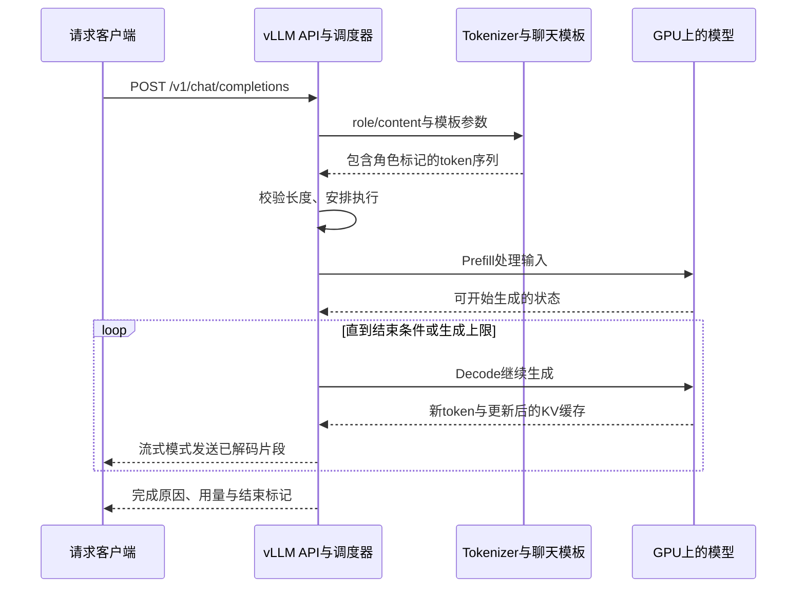

# 推理原理与性能实验：从一次回答读懂模型服务

本章接在 [服务器部署](服务器部署.md) 后面。你已经能收到模型回答，下一步要能解释：输入怎样进入模型，时间花在哪里，显存为什么没有随着请求结束立即下降，以及怎样设计一次能说明问题的对照。

学习时分四次完成下方实验，每次只改变一个因素。全文使用已有的 `tencent/Hunyuan-1.8B-Instruct` 服务，不启动第二个模型实例；也不使用历史 Qwen 的 `inference/benchmark.py`。所有数值结论都要由你自己的记录得出，本章没有提供新的 GPU 实测成绩。

## 1. 先画出一条请求的完整路径

**先做练习：** 在纸上写出“文字 → 模型 → 文字”，再尝试补上其中缺少的步骤。分别标出哪一步主要处理文字格式、哪一步需要 GPU、哪一步产生你在终端看到的等待时间。

**提示：** 模型接收的不是网页上那段原始中文，也不直接接收 Python 的 `messages` 字典。



这里画的是直接访问 **18301 模型服务**。访问 **18300 的 `/api/ask`** 时，前面还会增加检索、上下文组装，后面还会增加答案解析和记录保存。两条链路的耗时不能当成同一个指标。

### 1.1 Tokenizer：为什么“64 token”不是“64 个汉字”

Token 是模型词表中的单位，可能对应一个字、多个字符、标点或特殊标记。不同模型的同一句话可能得到不同的 token 数。不要用 Python 的 `len(text)`、SSE 片段数或者汉字个数代替模型返回的 `usage.completion_tokens`。

聊天模板把 `system`、`user`、`assistant` 等消息放进模型接受的格式，同时添加相应控制标记。`add_generation_prompt=True` 用于提示模型接下来生成助手内容；模板和 tokenizer 都应来自同一份模型。具体格式和这个参数的作用见 [Transformers 4.57.1 聊天模板文档](https://huggingface.co/docs/transformers/v4.57.1/chat_templating)。

本项目请求中传入 `chat_template_kwargs: {"enable_thinking": false}`，本地计数也传入同一参数。这样可以减少“计数时一种模板、请求时另一种模板”的偏差。混元的思考模式开关由其模板支持，不能假定任意模型都认识这个参数；参见 [腾讯模型卡的使用说明](https://huggingface.co/tencent/Hunyuan-1.8B-Instruct#use-with-transformers)。

### 1.2 Prefill：先理解已有输入

生成之前，模型要处理提示中的 token，得到当前上下文所需的中间状态。输入越长，需要处理的内容通常越多，但实际耗时还受到硬件、执行策略和排队影响。

“问题短”不代表“输入短”。在知识库问答中，输入还包括系统要求、检索片段、来源标记、聊天模板。用户只输入十几个字，模型实际收到的提示也可能已有上千 token。

### 1.3 Decode：在已有上下文上继续生成

自回归生成依次决定后续 token。KV 缓存保存已处理 token 在注意力层中的 Key 和 Value，后续步骤可以复用，避免重复计算相同历史位置的这些表示。它不是完整问答的答案缓存；缓存增长与序列长度、模型结构及精度有关。原理见 [Transformers 的 KV 缓存说明](https://huggingface.co/docs/transformers/v4.57.1/cache_explanation)。

本项目关闭的是**跨请求前缀缓存**，不是关闭一次生成内部的 KV 缓存。不要把 `--no-enable-prefix-caching` 理解成“每个 token 都完全从头计算”。

<details>
<summary>完成路径图后核对自己的解释</summary>

能收到一个 JSON，说明客户端、HTTP 接口及一条计算路径至少完成了一次协作；它还不能证明回答正确，也不能证明并发时稳定。你应能沿着图指出：模板影响输入格式，prefill处理输入，decode继续生成，排队发生在执行前，网络与输出缓冲影响客户端看到内容的时间。

</details>

## 2. 显存读数究竟由什么组成

**先做练习：** 假设模型名写着“1.8B”，为什么不能据此断言它只需 1.8 GiB 显存？请求结束后显存仍被占用，是否一定是内存泄漏？先写两种解释，再看下面的表。

| 部分 | 为何占空间 | 是否随一个请求结束而归零 |
|---|---|---|
| 模型权重 | 网络计算使用的参数 | 常驻服务通常继续保留 |
| KV 缓存 | 保存序列的注意力历史状态 | 序列使用的块可回收，但引擎的缓存池可继续占用显存 |
| 激活与工作区 | 当前计算产生的中间张量、算子临时空间 | 使用情况会变化；不等于驱动立即归还同量显存 |
| 框架和运行时 | 内存分配器、CUDA 上下文等 | 与进程和执行方式相关 |

下面只是**教学估算**：若恰有 `1.8 × 10^9` 个参数，且所有参数都按每个 2 字节存储，则参数数据约为 `3.6 × 10^9` 字节，即约 `3.35 GiB`。它没有包括上表的其他部分，也没有核对实际参数数目、共享权重或文件布局，不能作为该混元实例的实际显存结论。

- `1 MiB = 2^20` 字节；`1 GiB = 2^30` 字节，因此 MiB 除以 1024 才是 GiB。
- GB 常用十进制 `10^9` 字节。把 GB 和 GiB 混用，会让两个本来一致的读数看起来不一致。
- `nvidia-smi` 的整卡占用包括其他进程。需要同时确认自己的模型进程，不能把整卡数值全部归到本实验。
- PyTorch 的 `memory_allocated` 与 `memory_reserved` 分别反映张量分配和分配器管理的空间，均不等同于整卡用量。另起一个 Python 进程查它们，也读不到 vLLM 进程的完整占用。说明见 [PyTorch 2.9 CUDA 内存管理](https://docs.pytorch.org/docs/2.9/notes/cuda.html#memory-management)。

如果请求结束后服务仍常驻，权重和缓存池继续占用显存是合理现象。真正怀疑泄漏时，应在相同负载、同一进程的多次完成请求后观察是否持续增长，并核对引擎状态；一张截图不能证明泄漏。

## 3. 先读懂当前服务的限制

以下配置来自仓库的 [启动脚本](../inference/start-hunyuan.sh)，不是对所有部署的建议：

| 当前配置 | 在本项目中的含义 | 容易误读的地方 |
|---|---|---|
| `--dtype bfloat16` | 模型以指定浮点类型加载和执行 | 不表示权重文件大小就是进程显存大小 |
| `--max-model-len 2048` | 这次服务的输入与生成总长度上限 | 不是模型卡宣称的最大上下文长度 |
| `--max-num-seqs 1` | 调度配置限制同时处理的序列数 | 不等于 HTTP 层最多只能连接一个客户端 |
| `--max-num-batched-tokens 2048` | 单次调度迭代的 token 预算 | 不等于每秒能生成 2048 token |
| `--gpu-memory-utilization 0.28` | 本实例的显存规划比例 | 不是“GPU 计算利用率限制为 28%” |
| `--enforce-eager` | 使用 eager 执行配置 | 该配置下的成绩不能直接代表其他执行方式的成绩 |
| `--no-enable-prefix-caching` | 关闭跨请求前缀复用 | 不等于没有自回归 KV 缓存 |

显存规划比例是相对目标卡总显存的配置，不是相对当前剩余显存；它也不是多用户间的硬隔离。脚本启动前要求目标卡至少有 12 GiB 空闲，这是本项目为约 32 GiB 卡设置的启动检查。参数定义见 [vLLM 缓存配置](https://docs.vllm.ai/en/v0.11.2/api/vllm/config/cache/) 和 [调度配置](https://docs.vllm.ai/en/v0.11.2/api/vllm/config/scheduler/)。

不需要为了本章增大这些限制。不要同时启动第二实例、直接增加并发，或通过重启服务打断正在进行的其他练习。

## 4. 把时间和速率的测量边界写清楚

**先做练习：** “生成 40 token，共花 2 秒”能否推断 GPU 的 decode 速度是 20 token/s？缺少了哪些时间信息？

| 本章记录 | 测量边界 | 可以回答什么 |
|---|---|---|
| `elapsed_seconds` | 发出本次 HTTP 请求前，到响应接收、解析与连接清理完成 | 这个客户端完成一次请求等了多久 |
| `first_content_seconds` | 发出请求前，到收到第一个非空 `delta.content` | 客户端多久开始看到内容；仅流式有值 |
| `completion_tokens` | 服务端返回的真实生成 token 数 | 实际生成了多少，而非允许生成多少 |
| `output_tokens_per_e2e_second` | 生成 token 数除以完整请求耗时 | 端到端输出速率；包含排队和处理输入等时间 |
| 服务端队列、prefill、decode 指标 | 引擎自身的指标采样边界 | 帮助定位服务内部阶段，不能从客户端总耗时直接拆出 |

`first_content_seconds` 不是引擎内部“第一个 token 完成计算”的精确时间。一个 SSE 事件可能携带多个 token 对应的文本；第一个事件也可能只有角色而没有内容。我们跳过空内容事件，但返回的格式标签仍可能是第一个非空文本，因此它也不一定是用户答案的第一个字。

**教学示意，非实测：** 同样生成 40 token，完整等待 2 秒时端到端速率为 20 token/s；若其中 1 秒在排队，不能把 20 token/s 当作纯 GPU decode 速度。多个并发请求的系统吞吐应按共同的墙钟观察窗口计算，不能简单把每个请求的 token/s 相加。服务端指标的定义见 [vLLM Production Metrics](https://docs.vllm.ai/en/v0.11.2/usage/metrics/)。

当前只做串行对照。即使两个 HTTP 请求都被接收，`max-num-seqs=1` 下仍可能发生等待；“开更多终端”不是免费的加速方法。

## 5. 准备一个可重复使用的观测客户端

**前提：** 按 [服务器部署](服务器部署.md) 启动过 18301 服务；下列命令在服务器的项目根目录执行。现在只检查它，不重复启动。

```bash
source config.example.sh
curl -fsS --max-time 10 http://127.0.0.1:18301/v1/models
nvidia-smi --query-gpu=index,name,memory.used,memory.free,utilization.gpu --format=csv
mkdir -p evidence/inference-learning
```

服务列表应包含 `tencent/Hunyuan-1.8B-Instruct`。若型号、服务身份或资源窗口与预期不符，先处理环境，再做实验。前台终端正在运行服务时，应另开一个 SSH 终端；不要在服务日志后直接粘贴 Python 命令。

下面创建一个本地教学客户端。它不加载生成模型，只在 CPU 使用 tokenizer 检查输入长度，然后调用已有服务。每次最多生成 64 token；请求阶段的错误保留在独立 JSON 中，遇到失败退出，不自动重试。本地 tokenizer 或长度预检查失败时只报告终端错误，不发送生成请求。

```bash
cat > evidence/inference-learning/client.py <<'PY'
import argparse
import json
import os
import re
import time
from datetime import datetime, timezone
from pathlib import Path

import httpx
from transformers import AutoTokenizer

parser = argparse.ArgumentParser()
parser.add_argument("--label", default="probe")
parser.add_argument("--tokens", type=int, choices=[16, 32, 64], default=32)
parser.add_argument("--repeat", type=int, choices=[0, 10, 30], default=0)
parser.add_argument("--stream", action="store_true")
args = parser.parse_args()
if not re.fullmatch(r"[a-z0-9_-]+", args.label):
    parser.error("label只使用小写英文、数字、下划线和短横线")
model = "tencent/Hunyuan-1.8B-Instruct"
messages = [
    {"role": "system", "content": "你是技术助教，请用简洁中文回答。"},
    {"role": "user", "content": "背景资料：GPU可以并行计算。\n" * args.repeat
        + "请解释GPU推理时，输入处理与逐步生成有什么不同。"},
]
tokenizer = AutoTokenizer.from_pretrained(
    os.environ["CAPSTONE_TOKENIZER"], local_files_only=True)
prompt_tokens = len(tokenizer.apply_chat_template(
    messages, tokenize=True, add_generation_prompt=True, enable_thinking=False))
if prompt_tokens + args.tokens > 2048:
    raise SystemExit("超过当前服务2048 token预算，请缩短输入")
request = {"model": model, "messages": messages, "max_tokens": args.tokens,
    "temperature": 0, "top_p": 1, "seed": 42, "repetition_penalty": 1.05,
    "chat_template_kwargs": {"enable_thinking": False}, "stream": args.stream}
if args.stream:
    request["stream_options"] = {"include_usage": True}
record = {"label": args.label, "request": request,
    "local_prompt_tokens": prompt_tokens, "status": "failed",
    "timing_scope": "client_http_request", "first_content_seconds": None,
    "response": None, "events": [], "usage": {}, "text": ""}
started = None
try:
    with httpx.Client(base_url="http://127.0.0.1:18301",
            timeout=httpx.Timeout(30, connect=5), trust_env=False) as client:
        catalogue = client.get("/v1/models")
        catalogue.raise_for_status()
        if model not in [item["id"] for item in catalogue.json()["data"]]:
            raise RuntimeError("服务没有公布预期混元模型")
        started = time.perf_counter()
        if args.stream:
            done, reason = False, None
            with client.stream("POST", "/v1/chat/completions", json=request) as response:
                record["http_status"] = response.status_code
                if response.is_error:
                    record["response"] = response.read().decode("utf-8", errors="replace")
                response.raise_for_status()
                for line in response.iter_lines():
                    if time.perf_counter() - started > 60:
                        raise TimeoutError("流式观测超过60秒预算")
                    if not line.startswith("data:"):
                        continue
                    data = line[5:].strip()
                    if data == "[DONE]":
                        done = True
                        break
                    event = json.loads(data)
                    record["events"].append(event)
                    if event.get("usage"):
                        record["usage"] = event["usage"]
                    for choice in event.get("choices", []):
                        content = choice.get("delta", {}).get("content") or ""
                        if content and record["first_content_seconds"] is None:
                            record["first_content_seconds"] = time.perf_counter() - started
                        record["text"] += content
                        reason = choice.get("finish_reason") or reason
            record["finish_reason"] = reason
            if not done or reason is None:
                raise RuntimeError("流未完整结束，不能计为成功请求")
        else:
            response = client.post("/v1/chat/completions", json=request)
            record["http_status"] = response.status_code
            record["response"] = response.text
            response.raise_for_status()
            payload = response.json()
            choice = payload["choices"][0]
            record["text"] = choice["message"].get("content") or ""
            record["usage"] = payload.get("usage") or {}
            record["finish_reason"] = choice.get("finish_reason")
            if record["finish_reason"] is None:
                raise RuntimeError("响应缺少完成原因")
        record["status"] = "completed"
except Exception as error:
    record["error"] = f"{type(error).__name__}: {error}"
finally:
    elapsed = time.perf_counter() - started if started is not None else None
    record["elapsed_seconds"] = elapsed
    count = record["usage"].get("completion_tokens")
    record["output_tokens_per_e2e_second"] = (
        count / elapsed if record["status"] == "completed"
        and isinstance(count, int) and elapsed else None)
    record["usage_missing"] = not record["usage"]
    stamp = datetime.now(timezone.utc).strftime("%Y%m%dT%H%M%S%fZ")
    output = Path(__file__).parent / f"{stamp}-{args.label}.json"
    output.write_text(json.dumps(record, ensure_ascii=False, indent=2) + "\n", encoding="utf-8")
    if args.stream:
        print()
    print(json.dumps(record, ensure_ascii=False, indent=2))
    print("Saved:", output)
raise SystemExit(0 if record["status"] == "completed" else 1)
PY
```

先读清楚三个设计：计时不包含本地 tokenizer 加载和模型列表检查；`usage_missing=true` 时不编造 token 数；流式必须收到完成原因和 `[DONE]`。HTTP 的读等待超时为 30 秒，流式每次收到事件时还检查 60 秒总时长预算；不要把它当成精密的性能基准工具。

本客户端记录流式内容的到达时刻，但两种模式都在计时结束后才打印完整记录，避免把逐片段终端刷新与SSH输出开销额外加入流式耗时。这是测量用客户端；它不在终端实时逐字展示答案。

这些请求字段由 [vLLM OpenAI 兼容接口](https://docs.vllm.ai/en/v0.11.2/serving/openai_compatible_server/) 接收；流式用量选项可在 [v0.11.2 的协议定义](https://github.com/vllm-project/vllm/blob/v0.11.2/vllm/entrypoints/openai/protocol.py) 核对。每次观测都保留完整请求，便于检查是否真的是相同条件。

## 6. 实验一：完整解释一条短请求

**任务与预测：** 先预测 `--tokens 32` 是否一定会返回 32 个 token，并写出理由。尝试说出模型返回成功之后仍需检查的两个字段。

**提示：** 生成上限和实际生成量不是同一个值；完成原因比“看到了中文”更有诊断价值。

```bash
.venv-app/bin/python evidence/inference-learning/client.py --label single --tokens 32
```

依次检查 `status`、`http_status`、`text`、`usage`、`finish_reason`，最后看时间。`finish_reason=length` 说明本次达到了长度限制，文本可能没说完；它与连接失败不同。`stop` 也不保证回答内容正确，仍要读文本。

| 项目 | 填入自己的观测 |
|---|---|
| 服务模型、时间和 GPU 当前负载 |  |
| 输入 token / 实际输出 token |  |
| 完成原因、是否完整回答问题 |  |
| 完整请求耗时、记录文件名 |  |

**验收：** 能指出响应中的真实生成量，并用自己的话解释为何 `elapsed_seconds` 包含更多内容而非只有 GPU 算法时间。保存失败记录也可以完成一次有效的排障练习。

**常见错因：** `Connection refused` 先查服务和端口；环境变量缺失先重新 `source config.example.sh`；缺 tokenizer 文件先核对模型目录。不要用重复启动模型来处理所有错误。

## 7. 实验二：只改变允许生成的长度

**任务与预测：** 问题、模板、采样设置全部固定，将生成上限设为 16、32、64。预测哪一组更可能被截断，哪一组可能耗时更长。

**提示：** 如果模型在 25 token 就自然结束，允许 64 token 也不会强制它生成到 64。第一次请求还可能受到初始化状态影响，不能直接当作稳定基线。

```bash
for limit in 16 32 64; do
  .venv-app/bin/python evidence/inference-learning/client.py \
    --label "length-$limit" --tokens "$limit" || break
  sleep 2
done
```

这是明确有界的三次串行请求。遇到失败后停止后续配置，不自动重试。每次之间暂停两秒只是让练习节奏清楚，不保证共享服务器负载一致。

| 上限 | 实际输出 token | 完成原因 | 总耗时 | 端到端 token/s | 回答是否说完 |
|---:|---:|---|---:|---:|---|
| 16 |  |  |  |  |  |
| 32 |  |  |  |  |  |
| 64 |  |  |  |  |  |

**验收：** 用实际输出量解释时间变化；不能写成“上限翻倍，所以耗时必然翻倍”。只有三次单样本时，应写“观察到的现象”，不报告可信的 P95 或稳定吞吐能力。如果需要重复，应在下一次独立练习中按相同顺序再测，并分别保留各轮，不删掉慢样本。

## 8. 实验三：保持问题不变，增加输入背景

**任务与预测：** 固定输出上限为 32，只将辅助背景从 0 次增加到 10 次、30 次。预测提示 token 和第一个内容片段的等待是否改变。

**提示：** 这里重复的背景是人为构造的输入长度实验，不是有意义的知识库。增加输入长度也可能改变模型的回答，必须同时观察输出量。

```bash
for repeat in 0 10 30; do
  .venv-app/bin/python evidence/inference-learning/client.py \
    --label "prompt-$repeat" --tokens 32 --repeat "$repeat" --stream || break
  sleep 2
done
```

| 背景次数 | 本地提示 token | 服务端提示 token | 首个内容等待 | 总耗时 | 实际输出 token |
|---:|---:|---:|---:|---:|---:|
| 0 |  |  |  |  |  |
| 10 |  |  |  |  |  |
| 30 |  |  |  |  |  |

本地模板计数与服务端用量应先核对；不一致时优先检查模型/tokenizer版本、模板参数和实际服务身份。不要在计数不一致的前提下贸然认定上下文预算正确。

**验收：** 能说明较长提示为何增加 prefill 工作，并同时承认客户端首内容等待还包含排队、网络和分片交付。三个点不足以分离这些因素；即使时间没有单调增加，也应保留结果，而不是改数字凑成预期趋势。

## 9. 实验四：比较“一次返回”与“逐段返回”

**任务与预测：** 对同一个 32-token 请求分别使用非流式和流式。先预测哪种模式能更早展示部分内容，并判断流式是否必然减少整段回答的生成时间。

**提示：** 流式改变的是交付过程。数据到达客户端的片段边界不等于模型 token 边界，完整完成时间与开始显示时间要分开记录。

```bash
.venv-app/bin/python evidence/inference-learning/client.py --label plain --tokens 32 && \
.venv-app/bin/python evidence/inference-learning/client.py --label stream --tokens 32 --stream
```

`&&` 使第一条失败时不执行第二条；先排障，再单独重做这组对照。每个文件记录自己的完整请求；比较时确认除 `stream` 与 `stream_options` 外输入相同。两种模式都在计时后打印记录；`first_content_seconds` 在收到首个内容时记录，不用肉眼估算。服务端状态、CPU解析与网络分片仍可能影响结果，这两次请求不是严谨的重复性能基准。

| 模式 | 是否有首内容时间 | 完整耗时 | 实际输出量 | 文本是否完整 | 是否收到正常结束 |
|---|---|---:|---:|---|---|
| 非流式 | 不提供此测量 |  |  |  |  |
| 流式 |  |  |  |  |  |

**验收：** 读取流式记录的 `events`，找到第一个非空 `delta.content`、结束原因和用量事件。能解释为什么角色事件不该记为首个内容。若 `usage_missing=true`，把速率视为缺失，不用事件数量补算 token 数。

**失败判断：** 已收到一半文字但没有完整结束，不算成功请求；连接中断应记录为部分结果。完整接收但 `finish_reason=length` 是生成达到上限，和网络中断分开分析。固定 seed 也不构成跨负载、跨实现完全相同输出的保证。

## 10. 把观测变成可以交付的结论

完成四个实验合计为九次短请求，每次最多 64 个新 token；不要一次追加大规模压测。先把自己的数据写进下表，再决定下一次需要验证哪个疑点。

| 报告部分 | 应写的内容 |
|---|---|
| 问题 | 例如“增加输出上限是否让回答更完整，代价是什么” |
| 固定条件 | 模型/revision、精度、服务参数、模板、输入和采样设置 |
| 唯一变量 | 上限、背景次数或流式开关；一次只选择一项 |
| 实现证据 | 原始请求/响应文件、失败记录、资源采样和测量口径 |
| 结果 | 直接报告观测，区分截断、超时、缺失用量与成功完成 |
| 限制 | 单次/小样本、共享负载、未测GPU内部时间、未验证并发 |
| 学习证据 | 你操作前的预测、发现的偏差，以及用源码解释的一个现象 |

可按这个句式组织结论：“在____配置和____负载记录下，改变____后，实际输出从____变为____，完整请求耗时从____变为____。由于____没有被控制，我只能说明____，还不能证明____。”空格由自己的证据填写，不能直接搬用别人的数字。

最后回到 [服务层源码](../backend/services.py)，找出 `/api/ask` 的 1450-token 输入整理预算和固定 `max_tokens=384`。本章调参调用的是 18301 的模型接口，不是给 `/api/ask` 额外塞入一个未定义的 `max_tokens` 字段。能够说清这两个测量入口的差别，再进入 [RAG 链路与质量评测](RAG链路与质量评测.md)。
