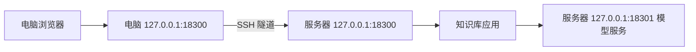

# 在自己的服务器部署混元知识库助手

这份说明从安装环境开始，直到一条真实问答返回。适用于 Linux x86_64、NVIDIA GPU 和 Python 3.11 及以上环境；下面以 Python 3.11 为例，与 CPU 检查版本一致。其他 Python 大版本、GPU 和驱动组合需要重新检查兼容性，不因版本更新就默认可用。

**公开包只启动两个服务：混元模型端口 18301，知识库应用端口 18300。** 它不包含原实验的 18123 兼容代理、18200 旧工作台或它们的运行环境。语料中的这些端口与 Qwen 配置属于保留的历史教学资料，不是本次安装步骤。

文中命令除“从自己的电脑访问”一节外，都在已经登录服务器的终端中执行。先进入解压后的仓库根目录，确认能看到 `config.example.sh`、`backend/` 和 `inference/`。不要在正在使用的共享 Python 环境中安装以下依赖。

## 0. 先理解“部署完成”的判断标准

先做一个预测：模型文件下载完、终端出现 `Application startup complete`、请求返回 HTTP 200，这三个信号分别证明什么？哪一个能单独证明知识库回答正确？

提示：把工作拆成文件、进程、接口和内容四层。部署完成至少需要以下可观察结果，而不只是“安装命令没有报错”：

| 层 | 要保存的证据 | 还不能据此断言什么 |
|---|---|---|
| 文件 | 模型版本、完整文件、校验清单 | 不能证明驱动兼容或模型能加载 |
| 进程 | 启动日志、进程存活、监听地址 | 不能证明调用了期望的模型 |
| 接口 | 模型清单、正常请求、实际响应 | 不能证明所有问题都正确或能承受高并发 |
| 内容 | 回答与具体引用逐句对应 | 一条成功不能代表整个业务题集 |

部署是一套建立和验证运行条件的过程。先让每层可检查，再去做性能与质量优化，会更容易知道改动到底影响了哪里。

**如果你正在使用已经部署好的实验室服务，先执行第5节的健康检查。** 已经就绪时直接进入第6节请求验证；本章的安装与启动步骤用于自己的新部署目录，不要求再启动一份模型去抢相同端口和显存。

## 1. 确认解释器与资源

先运行只读检查：

```bash
pwd
python3.11 --version
nvidia-smi --query-gpu=index,name,memory.total,memory.free,utilization.gpu,driver_version --format=csv
free -h
df -h .
```

解释这些输出时，先确认单位与范围：

| 输出 | 应该怎样读 |
|---|---|
| `memory.total/used/free` | 对应整张卡的显存快照，包含其他进程，不能都归因于本项目 |
| `utilization.gpu` | 采样窗口中的GPU忙碌程度，不是“占用了多少显存”，也不是为你预留的算力比例 |
| `free -h` 的 `available` | 比只看 `free` 更有助于判断主机还能给新程序提供多少内存 |
| Swap 使用量 | 需要结合当前内存压力和实际变慢观察，不能单凭“已满”推断本次请求一定失败 |
| `df -h .` | 当前目录所在文件系统的余量，不是个人账号配额 |

显存采样字段的定义见 [NVIDIA nvidia-smi 文档](https://docs.nvidia.com/deploy/nvidia-smi/index.html)。若实验室启用了个人配额，可查询 `quota -s`；没有这个命令或没有输出时，应以实验室提供的配额信息为准，不能自行用 `df` 的数字代替。

记录采样时刻、目标卡编号以及自己的实验预计持续时间。资源快照有时效；前一天空闲，不保证今天启动时仍空闲。

如果使用兼容的 Python 3.12，下面创建环境时改用对应解释器名称。若服务器没有可用的 Python 3.11/3.12 或 `venv`，先安装到自己的用户目录或请管理员提供；不要用系统 Python 3.9 勉强执行。下载权重、应用环境与 CUDA 推理环境会占用多 GB 磁盘，应先确认个人配额，而不是只看文件系统剩余空间。

启动脚本默认选择物理 GPU 0，并要求当时至少有 12 GiB 空闲显存。默认规划比例 `0.28` 是针对约 32 GiB 卡的配置，目标为约 8–10 GiB 的实例预算；它不是 GPU 算力配额，也不是其他型号显卡上的通用最优设置。共享服务器上先确认自己的资源窗口，不停止其他人的任务。

## 2. 分别安装应用环境与推理环境

应用负责 FastAPI、Haystack、CPU 上的 BGE 检索，以及向模型服务发 HTTP 请求。先创建应用环境，再从 PyTorch 官方 CPU 源安装 PyTorch，最后安装项目依赖：

```bash
python3.11 -m venv .venv-app
.venv-app/bin/python -m pip install --upgrade pip
.venv-app/bin/python -m pip install torch==2.9.1 --index-url https://download.pytorch.org/whl/cpu
.venv-app/bin/python -m pip install -r requirements.txt
.venv-app/bin/python -m pip check
```

这里无需安装 torchvision、torchaudio 或 CUDA 版 PyTorch。CPU 安装源与版本可在 [PyTorch 历史版本安装表](https://pytorch.org/get-started/previous-versions/) 核对。本项目 `LocalModels` 没有将模型或输入迁移到 CUDA，向量模型与重排模型都在 **CPU**；生成模型只由另一个 vLLM 环境加载。

为什么要分环境？vLLM 对其 PyTorch、CUDA 运行库和编译组件有匹配要求，应用还需要 Haystack、FastAPI 和检索模型依赖。放在两个目录中，可以分别检查它们，减少修改应用依赖时影响模型服务的机会。虚拟环境隔离 Python 包，不会替你隔离整机 GPU 或修改 NVIDIA 驱动；参阅 [Python venv 文档](https://docs.python.org/3.11/library/venv.html)。

以后遇到“明明安装了包却找不到”的问题，先检查解释器，不要连续换几个 `pip install` 碰运气：

```bash
.venv-app/bin/python -c 'import sys; print(sys.executable); print(sys.version)'
.venv-app/bin/python -m pip --version
```

两条命令都应指向本项目的应用环境。`.venv-app/bin/python -m pip` 比一个来源不明的 `pip` 命令更容易核对。复制虚拟环境目录到另一台机器也不等于可复现安装，应按依赖清单重新创建。

为 vLLM 单独创建环境，不复用或覆盖 `.venv-app` 中的 PyTorch：

```bash
python3.11 -m venv .venv-vllm
.venv-vllm/bin/python -m pip install --upgrade pip
.venv-vllm/bin/python -m pip install vllm==0.11.2 --extra-index-url https://download.pytorch.org/whl/cu128
.venv-vllm/bin/python -m pip check
.venv-vllm/bin/python -c 'import torch, vllm; print("vLLM:", vllm.__version__); print("PyTorch:", torch.__version__); print("CUDA runtime:", torch.version.cuda)'
```

让 vLLM 自己解析匹配的 PyTorch 依赖，**不要再向此环境强行安装应用环境的 torch 版本**。vLLM 0.11.2 的 CUDA 12.8 安装方式和独立环境要求见 [官方 GPU 安装文档](https://docs.vllm.ai/en/v0.11.2/getting_started/installation/gpu/)。`nvidia-smi` 显示的 CUDA 字段与 Python 包的 `torch.version.cuda` 含义不同，不要求字符串完全相同，但驱动必须支持所用运行时。

若启动时报告缺少 `Python.h` 或 C 编译器，检查所选解释器对应的开发头文件和编译工具；这不是模型下载错误。可先定位头文件：

```bash
.venv-vllm/bin/python - <<'PY'
from pathlib import Path
import sysconfig
header = Path(sysconfig.get_path("include")) / "Python.h"
print("Python header:", header, "exists:", header.is_file())
PY
cc --version
```

缺少时请提供匹配当前 Python 版本的开发环境；不要照抄其他机器某个 Ubuntu 软件包的版本或私人目录。本公开包不携带原服务器的编译工具修补目录。

## 3. 载入模型目录与设备配置

每个准备启动服务的新终端，都要先进入仓库根目录，再载入配置：

```bash
source config.example.sh
printf '%s\n' "$FDE_MODEL_PATH" "$CAPSTONE_EMBEDDING" "$CAPSTONE_RERANKER"
```

`source` 在当前 shell 中执行文件，让后续启动的进程继承这些变量；单独执行 `bash config.example.sh` 会在子 shell 中运行，不能把变量留给当前终端后面的命令。这就是“配置看上去执行过，启动却仍使用默认目录”的一个常见原因。

本配置用 `$PWD` 计算相对位置，因此应先在仓库根目录执行。项目根目录不等于模型目录：前者放源代码，后者放 tokenizer、配置和权重；应用的数据目录又是第三类内容。先能解释三类目录，再进行路径修改。

默认目录位于仓库旁的 `../models/`，不放入 Git。若需要修改路径或 GPU，先在自己的终端设定变量，再载入配置。例如只在已确认自己可使用 GPU 1 时使用下面的设备设置：

```bash
export FDE_PHYSICAL_GPU=1
source config.example.sh
```

`CAPSTONE_MODEL_NAME` 必须保持为服务公布的 `tencent/Hunyuan-1.8B-Instruct`，`CAPSTONE_TOKENIZER` 指向同一份混元模型目录。更换目录时可以预先设置 `FDE_MODEL_PATH`、`CAPSTONE_EMBEDDING` 和 `CAPSTONE_RERANKER`。不要把完整凭据写入配置文件后公开。

## 4. 下载混元与两个 BGE 模型

先下载固定版本的混元，过程不启动 GPU：

```bash
unset HF_HUB_OFFLINE TRANSFORMERS_OFFLINE
HF_ENDPOINT=https://huggingface.co .venv-app/bin/python inference/download-hunyuan.py
```

脚本固定 `tencent/Hunyuan-1.8B-Instruct` 的 revision `de940610ab5d45b4fedbd37e08444d0dc502837c`，检查文件 SHA-256，并将清单保存到本地 `evidence/hunyuan-migration/model-manifest.json`。模型许可与使用方式见 [官方模型卡](https://huggingface.co/tencent/Hunyuan-1.8B-Instruct)。模型下载不等于模型服务已经启动。

随后从官方 BAAI 仓库下载向量和重排模型。以下脚本首次解析并保存各自的提交 SHA，之后重跑沿用已保存的 SHA；只下载本项目加载所需的配置、tokenizer、safetensors 和说明文件：

```bash
HF_ENDPOINT=https://huggingface.co HF_HUB_OFFLINE=0 .venv-app/bin/python - <<'PY'
import json
import os
from pathlib import Path
from huggingface_hub import HfApi, snapshot_download

manifest_path = Path("evidence/bge-downloads.json")
saved = json.loads(manifest_path.read_text()) if manifest_path.exists() else {}
api = HfApi()
models = [
    ("BAAI/bge-small-zh-v1.5", "CAPSTONE_EMBEDDING"),
    ("BAAI/bge-reranker-base", "CAPSTONE_RERANKER"),
]
for repo_id, variable in models:
    destination = Path(os.environ[variable]).expanduser().resolve()
    revision = saved.get(repo_id, {}).get("revision") or api.model_info(repo_id).sha
    snapshot_download(
        repo_id=repo_id,
        revision=revision,
        local_dir=destination,
        allow_patterns=["*.json", "*.txt", "*.model", "*.safetensors", "README*", "LICENSE*"],
        max_workers=2,
    )
    if not (destination / "model.safetensors").is_file():
        raise RuntimeError(f"下载未得到所需权重: {repo_id}")
    saved[repo_id] = {"revision": revision, "path": str(destination)}
    manifest_path.parent.mkdir(parents=True, exist_ok=True)
    manifest_path.write_text(json.dumps(saved, ensure_ascii=False, indent=2) + "\n")
    print(repo_id, revision, destination)
PY
```

来源为 [BGE-small-zh-v1.5](https://huggingface.co/BAAI/bge-small-zh-v1.5) 与 [BGE-reranker-base](https://huggingface.co/BAAI/bge-reranker-base)。`revision`、`local_dir` 和文件筛选参数见 [Hugging Face 下载文档](https://huggingface.co/docs/huggingface_hub/guides/download)。下载被中断可重跑；不要把未完成的目录当作已经准备好的模型。

用应用代码确认两个 BGE 模型能在 CPU 加载。这一步会使用主机内存，不占用生成模型的 GPU 显存：

```bash
CUDA_VISIBLE_DEVICES="" .venv-app/bin/python - <<'PY'
from backend.config import Settings
from backend.indexing import LocalModels

settings = Settings.load()
models = LocalModels(settings.embedding_model, settings.reranker_model)
print("Embedding device:", next(models.encoder.parameters()).device)
print("Reranker device:", next(models.ranker.parameters()).device)
print("Embedding dimension:", len(models.embed(["知识库切分有什么作用？"], query=True)[0]))
PY
```

预期两个 device 都是 `cpu`。如果缺 tokenizer 或权重文件，先处理下载/配置路径，不要转到 GPU 上碰运气。

## 5. 前台启动模型，再启动应用

**服务器终端 A**，在仓库根目录运行并保持终端打开：

```bash
source config.example.sh
bash inference/start-hunyuan.sh
```

等待 vLLM 输出服务已开始监听的日志。在另一个服务器终端检查模型身份：

```bash
curl -fsS http://127.0.0.1:18301/health
curl -fsS http://127.0.0.1:18301/v1/models
```

第二条应列出 `tencent/Hunyuan-1.8B-Instruct`；不要只根据进程存在判定启动成功。若显存不足，保持其他用户的任务不动，等待资源或重新评估自己的配置。

**服务器终端 B**，也进入仓库根目录，运行并保持终端打开：

```bash
source config.example.sh
bash start.sh
```

应用首次启动会加载 CPU 检索模型并初始化 `data/` 中的文档和索引，需要等待。启动完成后，用第三个服务器终端检查：

```bash
curl -fsS http://127.0.0.1:18300/api/health
curl -fsS http://127.0.0.1:18300/api/status
```

除了健康接口返回成功，还应确认状态中的模型名、`model_ready`、文档数量和索引版本。当前默认 2048 token 上下文、单个执行序列，不是大并发生产配置。

## 6. 完成一条端到端知识库请求

在仓库根目录的第三个服务器终端执行，保留自己的响应：

```bash
mkdir -p evidence
curl -fsS --max-time 180 http://127.0.0.1:18300/api/ask \
  -H 'Content-Type: application/json' \
  -d '{"question":"知识库片段为什么要保留来源位置？","mode":"hybrid","top_k":5,"rerank":false,"structured":true}' \
  -o evidence/first-ask.json
.venv-app/bin/python -m json.tool evidence/first-ask.json
```

核对回答、具体引用片段、`generation.model`、输入输出 token 与索引版本。HTTP 200 和 `supported=true` 都不是事实正确性的保证；需要自己把回答中的陈述与引用原文对应起来。只有这一步实际返回并保存了结果，才新增了你的推理实现证据。

公开包的静态教学问答不会自动变成你的运行记录。自己部署后生成的历史保存在本地 `data/`，不应原样上传为公开快照。

## 7. 从自己的电脑访问

在**自己的电脑终端**建立隧道。将示例中的 SSH 账号与主机名替换成自己的实际值：

```bash
ssh -N -L 18300:127.0.0.1:18300 your-user@your-server
```

保持隧道终端运行，再用电脑浏览器打开 `http://127.0.0.1:18300`。这里电脑的 18300 通过 SSH 转发到服务器的 18300；无需把模型端口暴露到公网。若电脑 18300 已被占用，可以将 `-L` 的第一个数字改成自己的空闲本地端口，并在浏览器使用那个端口。

本说明使用前台服务，没有自动安装 systemd 用户单元。停止时，在应用终端 B 和模型终端 A 分别按 `Ctrl+C`，等待退出日志；停止模型后再查看 `nvidia-smi` 确认自己的进程已释放资源。仅关闭浏览器或 SSH 隧道不会主动结束服务器上另一个终端里的模型进程。

### 为什么两个 `127.0.0.1` 含义不同



`-L 18300:127.0.0.1:18300` 的第一个端口在自己的电脑上监听，后面的主机和端口是通过 SSH 从服务器一侧连接的目标。`-N` 表示本次连接不执行远程命令；没有出现命令提示符也可能是在正常保持转发。参数依据见 [OpenSSH 的 -L 与 -N 说明](https://man.openbsd.org/ssh)。

排查连接时按下面顺序缩小范围：先在服务器 curl 应用，再在电脑建立隧道，最后访问电脑的本地端口。若第一步就失败，修改浏览器或重复建立隧道通常不能解决服务器进程的问题。

## 8. 哪些历史实验不能直接照着运行

- `training/experiment.py` 与原 QLoRA 配置是 **Qwen2.5-3B 专用的历史教学实验**。它还需要对应基座和单独的训练依赖；当前 `.venv-app` / `.venv-vllm` 不是完整训练环境。
- 不能把训练代码里的模型名换成 Hunyuan，就宣称完成混元微调。聊天模板、目标模块、量化兼容性、数据长度、保存重载与独立效果验证都需重新确认。
- `inference/benchmark.py` 的历史对照参数面向 Qwen 与旧 18123 接口，不能直接拿来声称当前混元服务的性能。
- 公开包不提供原始 Qwen 报告、训练曲线或适配器。历史语料中的运行描述是阅读材料，不代表这些服务已在你的机器启动。

先完成上述一条端到端请求，再选择一个控制变量的小实验。安装完成、请求成功、回答正确和自己掌握，分别记录，不能互相替代。

## 9. 出错时按证据定位，而不是重新安装一切

先描述“在哪台机器、哪个环境、哪条命令”失败，再选择下面的检查。表中的处理是诊断方向，不要求全部执行。

| 现象 | 先检查什么 | 可能的解释与下一步 |
|---|---|---|
| `python3.11: command not found` | `python3 --version`、已有解释器位置 | 命令名称与实际安装不一致；选择已有的兼容解释器，不复制别人的绝对路径 |
| `ensurepip is not available` | 当前 Python 是否支持创建带 pip 的 venv | 使用用户目录中具备完整 venv 的解释器，或请管理员提供；不向系统环境硬塞依赖 |
| `ModuleNotFoundError` | `sys.executable` 与对应 `python -m pip --version` | 包装进了另一个环境；确认应属于应用、推理还是训练环境 |
| 权重目录找不到 | 打印模型变量，检查是否在仓库根目录 source | 配置没有继承或路径不对；不要通过随意复制权重制造多个来源 |
| 下载中断、哈希不符 | 固定 revision、模型下载日志、实际文件 | 不把不完整文件当成成功下载；先恢复并通过校验 |
| `CUDA out of memory` | 当前目标卡显存、已有模型进程、上下文预算 | 已有负载或配置超出可用容量；先减少自己的需求或等待资源窗口 |
| GPU 1 已选择，程序却显示 `cuda:0` | 启动时 `CUDA_VISIBLE_DEVICES` 与 nvidia-smi 进程归属 | 进程内逻辑卡编号可能从0开始；不能只看字符串判断选错卡 |
| `Address already in use` | `ss -ltnp` 中对应端口 | 服务可能已经在运行；先验证它，不根据端口冲突直接结束进程 |
| `Connection refused` | 命令执行位置、监听地址、服务日志 | 目标地址没有可接受连接的服务，或访问了错误机器的回环地址 |
| `/api/health` 正常，但 `model_ready=false` | 18301 的 `/v1/models` 与 `CAPSTONE_MODEL_NAME` | 应用进程存在，但生成服务不可达或模型名不匹配 |
| HTTP 422 | JSON 字段类型、长度与枚举值 | 请求不符合输入模型，先修请求，不必调整 GPU |
| HTTP 409 | 同名文档、运行中评测、历史适配器提示 | 操作发生了项目约定的状态冲突，依据具体detail处理 |
| `/api/ask` 返回502 | 应用日志、18301服务、保存的 `ask_error` | 上游请求或响应解析失败，不能仅凭502定位为网络错误 |
| 提交资料后回答未更新 | `POST /api/reindex` 是否完成、索引版本 | 保存文档与重建索引不是同一步 |
| 回答有引用，但引用不支持结论 | `context_chunks`、`raw_model_answer` 与原文 | 进入质量评测流程，HTTP成功并不能替代内容审核 |

查看监听端口是只读操作：

```bash
ss -ltnp '( sport = :18300 or sport = :18301 )'
```

没有权限查看其他进程细节时，仍可先看端口是否监听。不要为了看完整列表而在共享主机上修改系统权限。

### 一份可用于求助的故障记录

先把以下模板填完整。隐藏服务器凭据，保留真正影响判断的配置和错误信息。

```text
发生时间：
执行位置：自己的电脑 / 已登录服务器
代码提交：
Python解释器与版本：
模型名称与revision：
操作前资源采样：
我运行的完整命令：
我预期看到：
实际HTTP状态、错误与关键日志：
已排除的原因及对应证据：
下一步只检查哪一个假设：
```

例如，“在电脑 curl 服务器回环地址失败，但服务器本机 curl 成功”已经把问题缩小到了访问位置或隧道；“打不开”则无法区分这两层。这样的记录也是FDE交付中沟通与复现问题的基础。

## 10. 停服、重启与验收表

先做练习：只停止自己的前台模型服务，保留应用。预测应用健康接口、`model_ready` 和问答分别会发生什么。提示：回看 [系统架构](系统架构与源码导读.md) 中的服务边界。

随后只在自己的实验窗口执行停服与恢复，避免同时叠加性能对照。恢复后重复同一条短请求，并记录模型名与索引版本；不要用“终端又有日志了”代替恢复验收。

本章采用前台运行。仓库中的 `scripts/ops.py` 是针对应用用户服务和默认数据目录的运维辅助脚本，它不负责完整安装模型服务，也不自动把当前终端的所有变量写入 systemd 单元。还未理解环境继承时，先完成前台流程，不要混用两套启动方式。

| 验收项 | 自己的证据 | 通过标准 |
|---|---|---|
| 解释器与依赖 | 两个环境版本、pip check结果 | 能说明哪个环境负责什么，无依赖冲突 |
| 模型文件 | revision与校验清单 | 权重完整，路径与配置一致 |
| 模型接口 | `/v1/models`、一次短请求 | 请求使用并返回期望的模型名 |
| 知识库接口 | status和first-ask.json | 有索引版本、真实生成与引用可核对 |
| 电脑访问 | SSH转发命令与页面观察 | 能解释本地和服务器端口的位置 |
| 资源释放 | 停止前后自己的进程和显存采样 | 能识别本项目进程已结束，而非误把他人的占用当失败 |
| 恢复 | 恢复后同一请求 | 已验证请求链路重新可用 |
| 内容核对 | 答案与原句对应表 | 明确哪些事实有依据，哪些仍需检查 |

<details>
<summary>完成停服预测后，查看参考解释</summary>

模型停止后，已完成初始化的应用可能继续响应 `/api/health`。`/api/status` 无法从模型清单确认可用状态时会报告模型未就绪。调用问答时仍要向上游发请求，因此可能得到应用包装的502错误。重启模型后要重新验证服务清单与生成，不能仅凭应用健康接口一直为200判断从未发生过故障。

</details>

完成以上验收后，进入 [推理原理与性能实验](推理原理与性能实验.md)。如果你的主要困难是“代码怎样连接起来”，先读 [系统架构与源码导读](系统架构与源码导读.md)。
