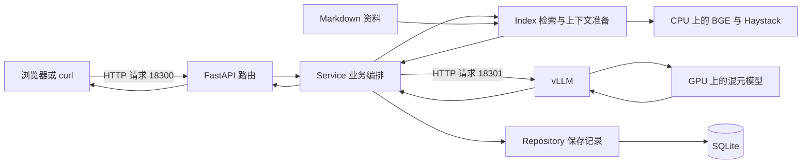

# 系统架构与源码导读：解释一条回答怎样产生

本章面向已经发出过 `curl` 请求、但还不能完整解释过程的学习者。读完后，你应能画出请求经过的组件，找出每个组件的代码，并把一个错误定位到大致的层。后面的部署、推理和 RAG 章节都建立在这张图上。

本章使用本仓库的真实实现。示例中的目录与输出仅用于说明结构；运行结果以你自己保存的记录为准。

## 1. 先完成一个不需要 GPU 的练习

先写下自己的预测，再看后文：

1. 浏览器收到一个 JSON 回答，是浏览器计算出的，还是服务器计算出的？
2. 如果模型服务停止，但应用进程仍运行，`/api/health` 是否一定报错？
3. 资料已经保存，为什么模型下一次回答仍可能看不到新内容？
4. 数据库里保存了成功回答，是否意味着这个回答的事实已经通过审核？

提示：在 [API 路由](../backend/main.py) 中查找 `health`、`add_document`、`reindex` 和 `ask`。先看函数调用谁，不急着逐行背代码。

## 2. 项目由哪些部分组成



这张图画的是服务器在线应用。公开 Pages 页读取打包时写入的教学快照，不会沿着右侧链路调用模型。

| 部分 | 真实位置 | 它负责什么 | 本项目中的边界 |
|---|---|---|---|
| 页面 | `web/` | 收集问题、展示结果、保存浏览器学习笔记 | 页面不是模型权重，也不是数据库 |
| API | `backend/main.py` | 校验输入，选择业务方法，返回 HTTP 状态和数据 | 不在路由里实现向量计算 |
| 业务层 | `backend/services.py` | 组织上下文、请求模型、处理输出、安排评测 | 一次回答需要协调多个组件 |
| 检索层 | `backend/indexing.py` | 文档管理、切分、索引、召回与重排 | 本项目 BGE 在 CPU 上计算 |
| 数据记录层 | `backend/repository.py` | 保存与读取实验记录 | 保存成功不等于语义审核成功 |
| 模型服务 | `inference/start-hunyuan.sh` | 以 HTTP 接口提供混元生成 | 单独的进程和 Python 环境 |
| 配置 | `backend/config.py`、`config.example.sh` | 决定文件路径、模型名和请求地址 | 写了配置不代表对应服务已启动 |

“分层”的价值可以用一次修改理解：如果你想让问题长度最多为 600 个字符，在 API 输入模型处检查；如果要解释上下文为什么丢掉最后一个片段，去业务层；如果文件保存了却没有进入索引，去检索层。不要在每一层都各写一遍相同规则。

## 3. 沿着一个请求阅读代码

先阅读下面的请求，不执行。用笔标出：地址、方法、请求头、请求体四部分。

```bash
curl -sS --max-time 180 http://127.0.0.1:18300/api/ask \
  -H 'Content-Type: application/json' \
  -d '{"question":"知识库片段为什么要保留来源位置？","mode":"hybrid","top_k":5,"rerank":false,"structured":true}'
```

这条命令应在已登录服务器的终端执行；`-d` 会使 curl 发送 POST。地址里的 `127.0.0.1` 是命令执行所在机器，不会自动指向实验室服务器。

### 第一站：把字节解释为有效输入

`main.py` 的 `AskQuery` 继承 `Query`。你可以把这些类理解成“这条接口接受什么数据”的明确约定。

| 字段 | 当前约束 | 为什么要知道 |
|---|---|---|
| `question` | 1–600 个字符 | 这是 API 长度限制，和模型 token 预算不是一个单位 |
| `mode` | `bm25`、`dense`、`hybrid` | 拼写错误不会自动变成相近的检索器 |
| `top_k` | 1–8，默认 5 | 它限制召回结果数，不保证这些结果全进入模型 |
| `rerank` | 布尔值，默认 false | 重排是可选计算步骤 |
| `structured` | 布尔值，默认 true | 开启本项目的 JSON Schema 输出约束 |

FastAPI 使用 Pydantic 输入模型处理请求体；输入不满足约束时，通常在到达业务函数之前返回 422。细节见 [FastAPI 请求体文档](https://fastapi.tiangolo.com/tutorial/body/)。

注意，当前 `/api/ask` 没有可配置的 `max_tokens` 字段；生成上限在 `Service.ask` 内固定为 384。该输入模型也没有配置 `extra='forbid'`，因此多加一个未知字段可能被忽略，不能据此认为实验变量生效。要改变生成上限，使用 [推理性能教程](推理原理与性能实验.md) 的模型接口实验。

### 第二站：召回资料并装入上下文

路由把 `body.model_dump()` 交给 `Service.ask`。业务层先调用 `Index.retrieve`，随后由 `_messages` 构造聊天消息。

这里至少有三组内容需要分开：

- **召回结果**：检索器认为相关的片段，保存在 `retrieval.chunks`。
- **实际上下文**：经过 token 预算裁剪后真正送入模型的片段，保存在 `context_chunks`。
- **最终引用**：解析模型引用编号后得到的片段，保存在 `citations`。

如果正确片段已经召回，却在上下文裁剪中被去掉，简单提高检索命中率不能直接解决回答问题。相反，如果上下文已经包含正确原句，但回答仍编造数字，就要进一步检查提示、生成和语义判断。

### 第三站：应用通过 HTTP 请求模型

应用进程没有把混元权重加载进自己内部；它向配置中的 `CAPSTONE_MODEL_URL + '/chat/completions'` 发请求。默认完整地址为 `http://127.0.0.1:18301/v1/chat/completions`。

这意味着两个独立的故障边界：应用可以正常启动，而模型端口不可达；模型可以正常生成，而资料索引无法初始化。排查时分别检查，而不是把所有失败都归因于“GPU 不行”。

`Service` 的 HTTP 客户端设置了连接和请求超时。超时是客户端没有在限定时间拿到期望响应，并不能自动证明服务器已停止计算。批量实验遇到超时应先保存失败，再检查当前服务状态。

### 第四站：解析、记录与返回

模型返回的是生成文本。应用还会解析 JSON、核对引用编号，并处理明确的无依据输出冲突。这里没有一个万能的“事实正确”判定器。

成功记录经 `Repository.save('ask', ...)` 写入 `data/history.sqlite3`。每条记录有 ID、时间、种类和 JSON 内容。当前实现用 SQLite 的事务保存记录；JSON 文件的原子写入函数用于其他落盘场景，不能把两种保存方式混为一谈。

如果模型调用或响应解析失败，代码会尝试保存 `ask_error`，随后向 API 层抛出错误。查历史时要看 `kind`，不要只数“产生了多少行记录”。

## 4. 怎样阅读一个回答 JSON

在服务器已完成部署时，把一次实际请求保存为 `evidence/first-ask.json`，再执行以下只读命令：

```bash
.venv-app/bin/python - <<'PY'
import json
from pathlib import Path
record = json.loads(Path("evidence/first-ask.json").read_text())
generation = record.get("generation", {})
print("record:", record.get("id"), record.get("kind"))
print("model:", generation.get("model"))
print("index:", record.get("index_version"))
print("tokens:", generation.get("input_tokens"), generation.get("output_tokens"))
print("retrieved:", len(record.get("retrieval", {}).get("chunks", [])))
print("context:", len(record.get("context_chunks", [])))
print("citations:", len(record.get("citations", [])))
print("answer:", record.get("answer"))
PY
```

| 字段 | 你应该问的问题 |
|---|---|
| `answer` | 有没有直接回答用户问题？有没有多说资料不支持的内容？ |
| `supported` | 这是应用输出的依据状态，还是我已经逐句确认的事实？ |
| `raw_model_answer` | 模型最初生成了什么？与最后展示内容是否不同？ |
| `generation.model` | 服务实际返回哪个模型名？是否与预期一致？ |
| `generation.finish_reason` | 是自然结束还是达到上限？达到上限时内容是否完整？ |
| `generation.elapsed_seconds` | 应用请求生成服务所花时间；它不是纯 GPU 内核时间 |
| 顶层 `elapsed_seconds` | `ask` 内从检索开始到响应解析完成的时长；不包括随后的记录落盘及浏览器到服务端的全部传输 |
| `index_version` | 以后重做时，能否确认使用了同一份知识？ |
| `citations` | 引文是否真的支持答案的数字、条件和日期？ |

如果把模型请求耗时和浏览器总耗时放到同一张“模型速度”表里，结论很容易失真。本项目没有通过这两个字段单独测量网络、排队和 GPU 计算各自占比。

## 5. 用配置理解“代码一样，为什么运行不同”

| 配置 | 它改变什么 | 常见误解 |
|---|---|---|
| `FDE_MODEL_PATH` | vLLM 加载的外置权重目录 | 改目录名就改变模型结构 |
| `CAPSTONE_TOKENIZER` | 应用做聊天模板和 token 预算的文件来源 | 任意 tokenizer 都能正确算混元 token |
| `CAPSTONE_MODEL_URL` | 应用请求的模型服务地址 | 写成 GitHub Pages 地址也能生成 |
| `CAPSTONE_EMBEDDING` | CPU 向量模型目录 | 换模型后可以沿用原来的所有向量 |
| `CAPSTONE_DATA` | 应用文档、索引和历史所在目录 | 它只决定日志保存位置 |
| `FDE_PHYSICAL_GPU` | 启动脚本暴露给模型进程的物理卡 | 程序显示 `cuda:0` 就一定是整机 GPU 0 |

配置以启动进程时的环境为准。你在另一个终端修改环境变量，不会自动改变已经运行的进程。一个可复现实验至少要记录代码提交、模型版本、相关配置、输入和实际输出。

## 6. 把故障沿着边界分解

先预测下面四种情况的排查顺序。提示：每一步都寻找能缩小范围的证据。

| 情况 | 第一条有用证据 | 再往哪一层看 |
|---|---|---|
| Pages 能打开，点击不了真实实验 | 页面顶部公开演示标记 | 静态页面边界，先连接服务器应用 |
| 电脑打不开页面，服务器 curl 正常 | SSH 隧道进程、本地端口 | 网络转发与浏览器访问位置 |
| `/api/health` 正常，`model_ready=false` | 服务器上的 `/v1/models` | 模型进程、端口、模型名或连接 |
| 问答成功但引用不支持结论 | 保存的原文、context 和 raw answer | RAG 的证据覆盖与生成环节 |

<details>
<summary>完成预测后，核对四个开头问题</summary>

在线回答由服务器业务链路计算，浏览器主要负责展示。`/api/health` 返回的是应用路由的固定健康响应，GPU 生成服务不可用时它仍可能成功。保存资料与建立新索引是分开的操作，新的文件要在重建后进入当前检索索引。数据库保存的是实验发生过什么，不是内容已通过人工审核的证明。

</details>

## 7. 怎样向别人讲清楚这个项目

先用三分钟写一段自己的介绍，再参考以下结构。每一句都要能指向代码或自己的实验记录：

1. **需求**：用户有什么需要回答的问题，资料来自哪里，哪些问题不在范围内。
2. **方案**：页面、API、检索、生成与记录分别承担什么工作。
3. **约束**：共享 GPU、单实例预算、上下文上限和资料版本如何影响方案。
4. **验证**：一个成功案例、一个失败案例，以及你如何找到原因。
5. **交付**：别人拿到仓库后怎样运行，出问题怎样定位和恢复。

“用了很多技术栈”无法替代这五个问题。FDE 学习的一个重要目标是把客户需求变成可运行、可解释、可验收的系统；这个学习项目提供的是一条练习主线，不代表已经覆盖所有真实企业场景。

## 本章验收

- [ ] 不看图，画出浏览器到模型再回到历史记录的链路。
- [ ] 能在四个后端文件中找到输入校验、上下文预算、召回和持久化的位置。
- [ ] 从一条自己的 JSON 中区分召回、上下文和引用。
- [ ] 用一个失败说明为什么 HTTP 成功与回答正确不同。

把解释与实际产物路径写进学习记录；仅阅读本章不自动算作完成。下一章：[服务器部署](服务器部署.md)。
